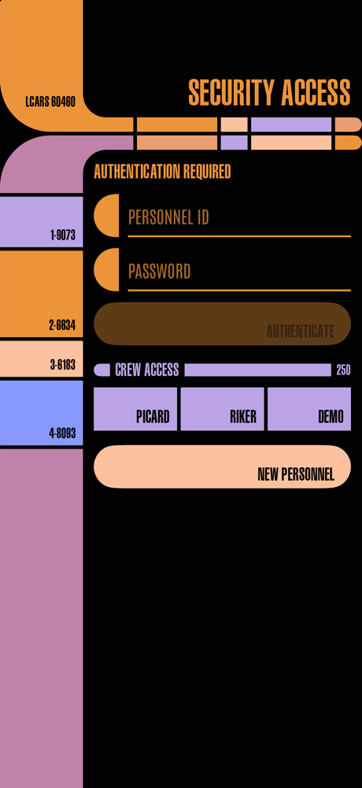
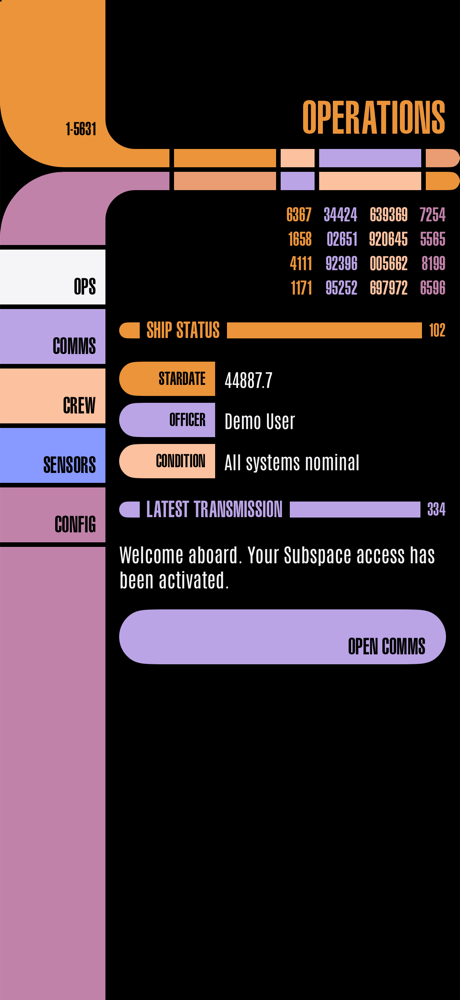
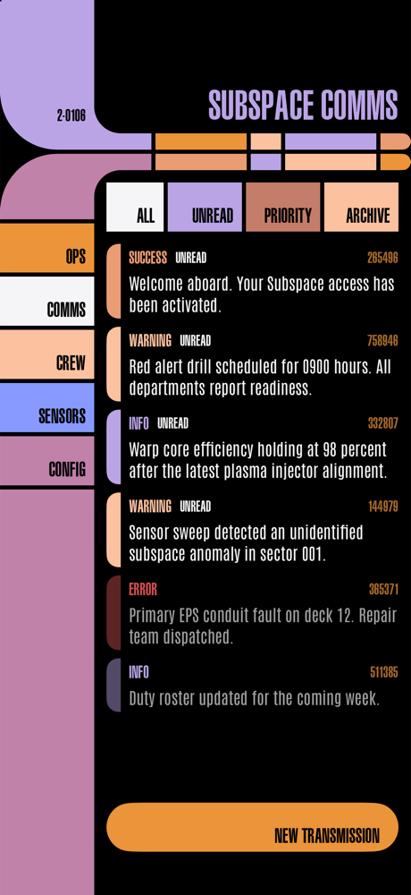

# Subspace

[](https://github.com/cliftonia/Subspace/actions/workflows/swiftlint.yml)


A messaging app for iOS with an LCARS-inspired interface, built in SwiftUI against its own Go
backend ([LCARS-BE-GO](https://github.com/cliftonia/LCARS-BE-GO)).

<p align="center">
  
  
  
</p>

It runs with no server by default: an on-device "local fleet" answers the same API, so the app can be tried straight
from Xcode. Point `API_BASE_URL` at the Go backend to use the real one.

## What's in it

- **Auth**: Sign in with Apple and Google, onboarding, tokens kept in the Keychain
- **Messages, Users, Profile, Dashboard**: feature modules, each with its own views and view models
- **Networking**: an `APIClient` with a retry policy, typed network errors, a response cache,
  and a `WebSocketManager` for live updates
- **Design system**: a standalone `ComponentLibrary` target with a showcase app, LCARS colours,
  frames, components and sound

## Architecture

Clean Architecture, with dependencies pointing inward:

```
Presentation (SwiftUI views, view models, navigation)
      ↓
Domain (entities, use cases, repository protocols — pure Swift)
      ↑
Data (API client, WebSockets, Keychain, cache, repository implementations)
```

The full layer map and rules are in [`docs/clean-architecture.md`](docs/clean-architecture.md). SwiftLint runs in CI
on every push.

## Running it

1. Open `Subspace.xcodeproj` and run the **Subspace** scheme on an iOS 26 simulator. Tap **Demo** on the sign-in
   screen; the local fleet serves everything on the device
2. Optional, for the real backend: start it as in [`docs/backend-setup.md`](docs/backend-setup.md) and set `API_BASE_URL` in the
   scheme's environment

The component library can be run on its own via the **ComponentLibrary** scheme.
